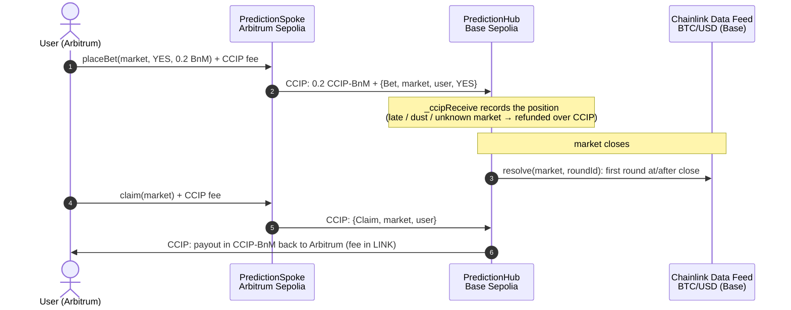
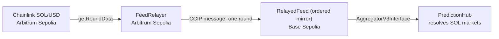

# Prophet: call it from any chain

**Price prediction markets with one shared pool on Base that you can bet on from Base, Arbitrum or Ethereum.**
Chainlink CCIP moves every stake into the pool and every payout back to your chain. Chainlink Data Feeds settle the result.

> **Live app:** _add the Vercel production URL_ · **Demo video:** _add link_ · Testnets only (Base, Arbitrum and Ethereum Sepolia)

**Chainlink requirement:**
- **CCIP state changes:** [`PredictionHub._ccipReceive`](src/PredictionHub.sol#L197) records every cross-chain bet and pays out claims; [`RelayedFeed._ccipReceive`](src/RelayedFeed.sol#L64) stores relayed SOL/USD price rounds.
- **Data Feeds:** every market is settled in [`PredictionHub.resolve`](src/PredictionHub.sol#L153).

---

## The problem

Prediction markets live on one chain. Users on other chains have to bridge before they can bet. Launching a copy of the market on every chain avoids the bridge but splits liquidity into thin pools with worse odds.

## What Prophet does

- **One pool, any chain.** Each market lives on a hub contract on **Base Sepolia**. You can bet straight on Base, or from **Arbitrum Sepolia** or **Ethereum Sepolia** through a spoke contract. The spoke sends your stake and your bet together in **one CCIP programmable token transfer**, and the hub records the position when the message arrives.
- **Winnings come back to you.** Claim on the chain you bet from. From Arbitrum or Ethereum Sepolia, the claim crosses to the hub over CCIP, and the hub sends your payout back to that chain over CCIP, with the return-trip fee paid by the hub in LINK. Bets placed on Base are paid out directly on Base.
- **Settled by Chainlink Data Feeds.** Each market asks "Will ETH/BTC/SOL be above $X at time T?" It settles on the **first feed round published at or after the close**. Anyone can trigger resolution, and nobody can pick which price is used.
- **Feeds from other chains, over CCIP.** Prophet relays Chainlink's SOL/USD rounds from Arbitrum Sepolia to an ordered mirror on Base over CCIP. The mirror implements `AggregatorV3Interface`, so the hub uses it like any native Base feed.
- **Parimutuel payouts.** Winners split the whole pool in proportion to their stake. A market with bets on only one side, or one that nobody resolves within a day of closing, is voided, and everyone can claim back their full stake.

## How it works



The SOL price takes a second CCIP route:



## Where Chainlink is used

Every CCIP message below changes contract state when it arrives (a bet recorded, a payout sent, a price round stored).

| Chainlink service | Where | What it does |
|---|---|---|
| **CCIP**: token + data | [`PredictionSpoke.placeBet`](src/PredictionSpoke.sol#L48), [`_buildMessage`](src/PredictionSpoke.sol#L80) | Sends the stake (CCIP-BnM) together with the bet intent in one programmable token transfer. The fee is paid in native gas, and `quoteBet` gives the price up front. |
| **CCIP**: receive | [`PredictionHub._ccipReceive`](src/PredictionHub.sol#L197) | Checks the sending chain and spoke against an allowlist, then records the bet or processes the claim. Late or invalid bets are refunded over CCIP instead of reverting, so tokens don't get stuck as long as the hub holds LINK for the return fee. |
| **CCIP**: token transfer | [`PredictionHub._sendTokens`](src/PredictionHub.sol#L234) | Sends payouts and refunds back to the bettor's chain, with the fee paid in LINK by the hub. |
| **CCIP**: claim message | [`PredictionSpoke.claim`](src/PredictionSpoke.sol#L62) | Asks the hub to pay out to this chain. |
| **CCIP**: data relay | [`FeedRelayer._relay`](src/FeedRelayer.sol#L64) → [`RelayedFeed._ccipReceive`](src/RelayedFeed.sol#L64) | Relays Chainlink SOL/USD rounds from Arbitrum to Base. The relay uses out-of-order execution, so CCIP gives no ordering guarantee; the mirror holds early rounds until the gap is filled and keeps round ids sequential. |
| **Data Feeds** | [`PredictionHub.resolve`](src/PredictionHub.sol#L153), [`findResolutionRound`](src/PredictionHub.sol#L324) | Settles each market on ETH/USD and BTC/USD (Base Sepolia) or the relayed SOL/USD. `resolve` checks that the chosen round is the first one at or after close, and `findResolutionRound` finds it by binary search. |
| **Data Feeds**: frontend | [`useFeedHistory`](frontend/src/lib/hooks.ts#L143), [`PriceChart`](frontend/src/components/PriceChart.tsx#L66) | Live price charts drawn directly from feed rounds, with the strike and the settlement round marked. |

## Deployed contracts

The same deployer nonce gives the hub and both spokes the same address.

| Chain | Contract | Address |
|---|---|---|
| Base Sepolia | `PredictionHub` | [`0xA278b4Df096E8596c9f23c86540ef489678bae7b`](https://sepolia.basescan.org/address/0xA278b4Df096E8596c9f23c86540ef489678bae7b) |
| Base Sepolia | `RelayedFeed` (SOL/USD mirror) | [`0x7feAA707fB0847B782f61509a7B4cf8A15055B35`](https://sepolia.basescan.org/address/0x7feAA707fB0847B782f61509a7B4cf8A15055B35) |
| Arbitrum Sepolia | `PredictionSpoke` | [`0xA278b4Df096E8596c9f23c86540ef489678bae7b`](https://sepolia.arbiscan.io/address/0xA278b4Df096E8596c9f23c86540ef489678bae7b) |
| Arbitrum Sepolia | `FeedRelayer` (SOL/USD) | [`0xbDe2FC16e9811Ee5bEa0A69568f16d9D207F5B40`](https://sepolia.arbiscan.io/address/0xbDe2FC16e9811Ee5bEa0A69568f16d9D207F5B40) |
| Ethereum Sepolia | `PredictionSpoke` | [`0xA278b4Df096E8596c9f23c86540ef489678bae7b`](https://sepolia.etherscan.io/address/0xA278b4Df096E8596c9f23c86540ef489678bae7b) |

Chainlink feeds used: ETH/USD [`0x4aDC…7cb1`](https://sepolia.basescan.org/address/0x4aDC67696bA383F43DD60A9e78F2C97Fbbfc7cb1) and BTC/USD [`0x0FB9…4298`](https://sepolia.basescan.org/address/0x0FB99723Aee6f420beAD13e6bBB79b7E6F034298) on Base Sepolia, and SOL/USD [`0x3237…A775`](https://sepolia.arbiscan.io/address/0x32377717BC9F9bA8Db45A244bCE77e7c0Cc5A775) on Arbitrum Sepolia. Bets are in CCIP-BnM, the CCIP test token, which has a public faucet. All addresses are also in [`deployments.json`](deployments.json).

## Proof it works on testnet

The main cross-chain paths have all run end to end on testnet: bets, claims, payouts, void refunds and the SOL relay.

| Path | Link |
|---|---|
| Bet from Arbitrum → recorded on the Base hub (market 0) | [CCIP tx 0xb49e6d3b…](https://ccip.chain.link/tx/0xb49e6d3bb02ad94bd02ebeca1a524e9cc08a55b62f6dd41492949da81c9084ed) |
| Bet from Ethereum Sepolia → recorded on the Base hub (market 9) | [CCIP tx 0xb3d41bdf…](https://ccip.chain.link/tx/0xb3d41bdfd55c63a80c6e36c1f8a7846f0836458d19af1d5da7ce13a2d321bf32) |
| Market 0 settled on Chainlink ETH/USD ($2,244.87 vs a $2,240 strike → YES) | [Base tx 0x027cf437…](https://sepolia.basescan.org/tx/0x027cf437b6d530cdfeb8c883f7157bd765e3e4e3f954158cb192c6a4757e5e50) |
| Market 0 won → 1 BnM payout sent from Base back to Arbitrum | [CCIP msg 0x7624fb68…](https://ccip.chain.link/msg/0x7624fb6869ac3d9973b3db70d55458add876c984438d33833976150fb6fe7512) |
| Market 8 voided → 0.5 BnM refund sent from Base back to Ethereum Sepolia | [CCIP msg 0x7c375e9b…](https://ccip.chain.link/msg/0x7c375e9b67040b8023f160d882dbae20488e3d7af4c3e5f6020dc845c3dd833b) |
| SOL/USD round relayed from Arbitrum to the Base mirror | [CCIP tx 0x7c4290c8…](https://ccip.chain.link/tx/0x7c4290c8a9176bd3517feecaf9518b8fe4a13803a932c2484123b6f6646fcbbc) |

Testnet CCIP waits for source-chain finality, so each leg takes about **20–25 minutes**. The app tracks bets and claims while they're in transit.

## Design notes

- **Settlement price can't be cherry-picked.** `resolve(id, roundId)` accepts only a round whose `updatedAt ≥ closeTime` and whose previous round in the same phase is before close. Resolution is permissionless and deterministic.
- **Incoming CCIP messages don't strand tokens.** A bet that arrives after close, below `MIN_BET`, or for a market that doesn't exist is refunded to its source chain instead of reverting. A reverting receive would leave the tokens waiting for manual execution. Claims that find nothing owed emit `ClaimIgnored` and never revert. The one exception is a hub that runs out of LINK: the refund or payout send then reverts, and the message waits for manual execution until the hub is topped up.
- **The relayed price feed is ordered and complete.** Relaying only the latest round would let anyone skip a round that resolves a market against them. `RelayedFeed` accepts source rounds strictly in order, holds rounds that arrive early, and can be drained by anyone. [`test/RelayedFeed.t.sol`](test/RelayedFeed.t.sol) includes this selective-relay attack as a test.
- **Escape hatches.** `voidStale` voids a market nobody resolved within `RESOLVE_GRACE` (1 day), so every bettor can claim a full refund. One-sided markets resolve as void without reading the feed.
- **Positions are per (user, chain).** Each position records the chain the stake came from, so payouts go back to the chain that paid in.

## The app

[`frontend/`](frontend) is a Next.js 16 app using wagmi and viem. It needs no backend or indexer: everything is read from the contracts and their event logs.

- **Markets:** live Chainlink prices, a moving price chart per market, and pool odds. Closed markets are tinted by result.
- **Bet from any chain:** pick the source chain and see the live CCIP fee. A testnet faucet button drips CCIP-BnM, and the app handles approval and the network switch.
- **In-flight tracking:** bets and claims in transit link to the CCIP Explorer.
- **Positions page:** one page per wallet, independent of the chain the wallet is on. It shows open positions, claimable winnings, CCIP trips in flight and settled history across all three chains. Positions and claimable amounts are read from the hub contract; history and in-flight trips come from on-chain event logs.
- **Permissionless upkeep:** anyone can resolve a closed market or relay the next SOL round from the UI.
- **Social:** "Dare a friend" share links with generated preview cards.
- **Wallets:** browser wallets (EIP-6963), Base Account (passkey), and WalletConnect.

## Run it

**Contracts** (Foundry; Solidity dependencies come from npm):

```bash
npm install
forge build
forge test                                               # 28 unit tests: hub, spokes, CCIP flow, relayed feed
FORK_TESTS=true forge test --match-path "test/fork/*"    # Base Sepolia fork tests (RPC: BASE_SEPOLIA_RPC_URL, default sepolia.base.org)
```

Deploying uses the scripts in [`script/Deploy.s.sol`](script/Deploy.s.sol): `DeployHub`, `DeploySpoke` (once per spoke chain), `SetSpoke`, `CreateMarket`, `Resolve`. The SOL relay uses `DeployRelayedFeed`, `DeployFeedRelayer` and `WireAssets`.
1. Copy `.env.example` to `.env`.
2. Fill in your key and the RPC URLs.
3. Add each script's extra values (`SPOKE_CHAIN_ID`, `SPOKE_ADDRESS`, `MARKET_ID`, `RELAYED_FEED`, `FEED_RELAYER`) as its header comment describes.

**Keepers.** Everything they do is permissionless and also available as buttons in the app. These two scripts automate it. They read `.env` and need `cast` and `python3`; `ONCE=1` runs a single pass.

```bash
bash script/relay-keeper.sh      # relays every new SOL/USD round from Arbitrum to Base, in order (needs FEED_RELAYER, RELAYED_FEED)
bash script/resolve-keeper.sh    # settles each market once its closing price exists; voids one-sided and stale ones
```

**Frontend:**

```bash
cd frontend
npm install
npm run dev     # http://localhost:3000
```

Optional env vars:
- `NEXT_PUBLIC_WC_PROJECT_ID`: a Reown project id; enables WalletConnect.
- `NEXT_PUBLIC_SITE_URL`: the canonical URL for share cards.

On Vercel, set the project's **Root Directory** to `frontend`.

## Limitations and what's next

- **Latency:** each cross-chain leg takes about 20–25 minutes on testnets because CCIP waits for finality. Bets close at market close, so a late cross-chain bet is refunded.
- **Upkeep runs from shell scripts for now:** resolving markets and relaying SOL rounds are permissionless, and today they run from two small keeper scripts. Next step: move both to **Chainlink CRE** workflows (or Automation) so they don't depend on one machine.
- **Return fees need LINK on the hub:** payouts and refunds are paid for from the hub's LINK balance, which the owner tops up.
- **Market #2 predates the ordered relay.** It is bound to the retired latest-only SOL mirror (`0x6105…6A9A`, now disallowed for new markets), so the ordered-relay guarantee doesn't cover it. It is expected to be voided after its grace period.
- **Scope:** price-threshold markets only, one bet token (CCIP-BnM), and testnets only.

## Repo layout

```
src/        PredictionHub, PredictionSpoke, FeedRelayer, RelayedFeed
test/       unit tests (CCIP local simulator) + Base Sepolia fork tests
script/     Foundry deploy/ops scripts, relay-keeper.sh, resolve-keeper.sh
frontend/   Next.js app (design system in frontend/DESIGN.md)
```
